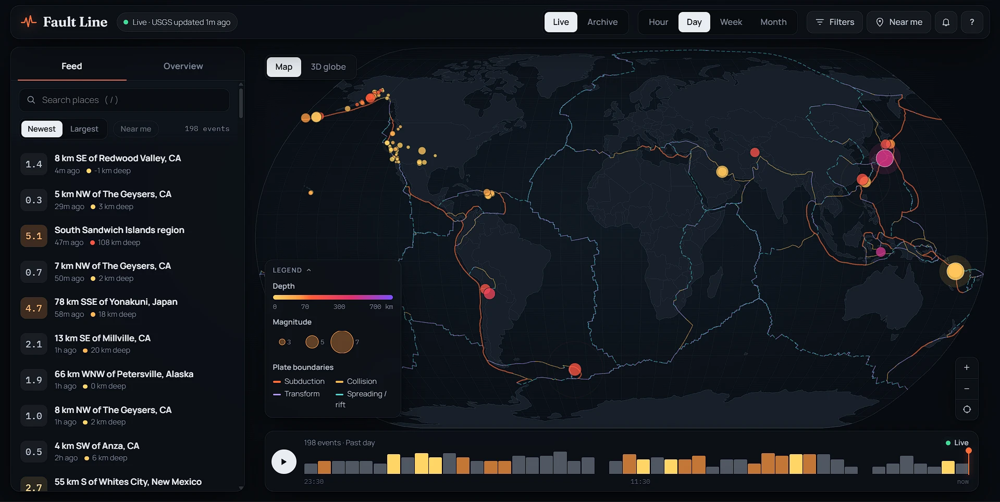
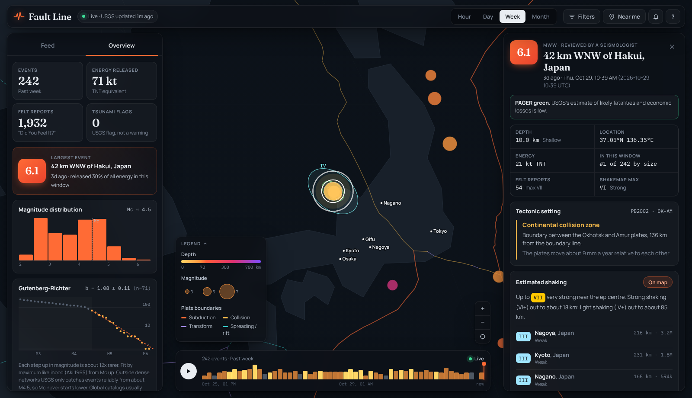
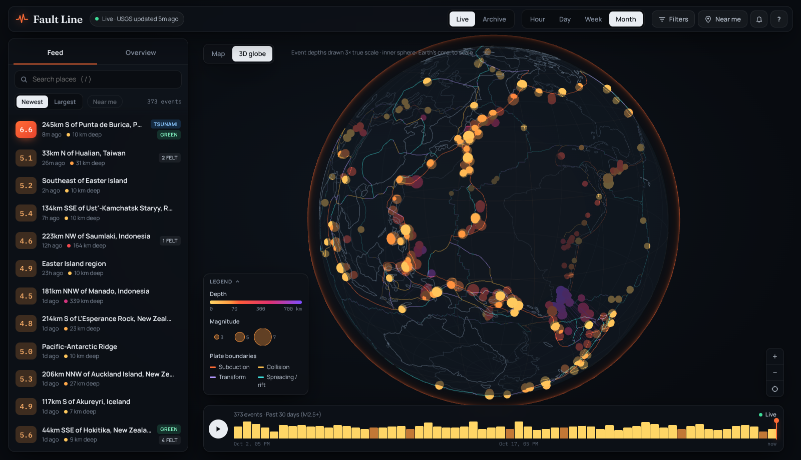

# Fault Line: Live Earthquakes on the Plates That Make Them

[](https://github.com/HalcyonVector/Fault-line/actions/workflows/ci.yml)

A live earthquake observatory. Every event the USGS has located in the last hour, day, week or month, drawn on a dark cartographic map of the tectonic plate boundaries that cause most of them. Pick any quake and it tells you which plates are involved and which one is diving under which, how strongly nearby cities probably shook, how many aftershocks have followed so far and how likely more are. Compare that estimate with what USGS actually measured (ShakeMap) and what people reported feeling. Spin a 3D globe where every quake sits at its true depth, so the slabs of subducting plates appear inside the Earth. Search the archive back to 1900, replay any window as an animation, set your location to see what you might feel, and get alerts when something big happens or something hits close to home.

Built with React, TypeScript, d3-geo, three.js and Express on free, keyless public data (the USGS real-time feeds, Peter Bird's PB2002 plate model and Natural Earth), ready to run for $0/month on Render.

> **What it's for:** keep it open in a tab to watch the planet's seismicity in real time, then click into any event to understand it the way a seismologist would read it, not just as a dot and a number.

**Live demo:** [fault-line.onrender.com](https://fault-line.onrender.com/) (Render's free tier sleeps when idle, so the first load can take up to a minute)







<sub>Screenshots were captured against a recorded USGS M2.5+ week feed from late November 2024, replayed through the app locally.</sub>

---

## Disclaimer

**Fault Line is not an early-warning system, a hazard tool or a safety-critical application of any kind**, and makes no claims to that effect. Shaking intensities and aftershock probabilities come from simplified published models applied globally, so treat them as informed illustrations, not forecasts. For anything that matters, use your national seismic agency, the official tsunami warning centres and the USGS event pages linked from every quake. See Honest Limitations for the specifics.

---

## Findings

Real problems found while building this, and what changed:

- **The global b-value came out at 0.32, which is physically implausible.** Fitting the Gutenberg-Richter slope above the completeness magnitude from maximum curvature looked textbook, but the USGS feed mixes networks: the US and a few other dense networks report quakes down to M2 and below, while most of the planet is only complete from about M4.5. Maximum curvature lands on the dense-network peak (Mc around 2.7), so the fit mixed complete and incomplete regions and dragged b far too low. Flooring the global completeness at M4.5 gives **b = 1.08 ± 0.11** on the same week of data, right where real global catalogs sit.
- **Bird's boundary codes quietly encode subduction polarity.** PB2002 writes boundaries as `NZ\SA`, `SU/AU` or `NA-PA`. The slash direction says which plate goes under: `A\B` means A subducts beneath B, `A/B` means B subducts beneath A. Checked against ten well-known zones (Nazca under South America, Pacific under Okhotsk, Philippine Sea under Amur, Australia under Sunda, India under Burma and others) before relying on it, so the app can say "the Nazca plate diving beneath the South America plate" rather than just "subduction zone".
- **The intensity model saturates for great earthquakes.** Atkinson & Wald (2007) grows its near-source distance term with magnitude, so an M9.5 at the epicentre comes out around intensity VII, where real great quakes reach IX or more. That is a property of the published equation, not a bug to paper over, so it is pinned in a unit test and listed under Honest Limitations.
- **An SVG glow filter drew a visible rectangle when zoomed in.** The filter region was rasterised inside a scaled group and showed as a lighter box around big events. Large quakes now get a soft halo circle instead, which is also cheaper to render.
- **The default view hid the Americas behind the event panel.** The map was fitted to the full window, under the floating panels. It now fits the world into the area the panels leave uncovered, and re-centres a selected quake within that area too.
- **Fly-to zoomed far too tight.** Sizing the zoom to the light-shaking (IV) radius alone put an M6 in a view only a couple of hundred kilometres across, often pinned at maximum zoom. It now frames well over 1,000 km, so nearby cities and the boundary it sits on stay visible.
- **"0m ago".** Events 45 to 59 seconds old were labelled "0m ago". Fixed and covered by a test.
- **USGS publishes "Did You Feel It?" cells as unclosed rings.** The 10 km grid gives each cell's four corners without repeating the first point, which GeoJSON (and d3) require, so every square drew as a thin sliver. The server now closes the rings, tested against a real USGS file.
- **USGS detail responses hand you URLs to fetch next.** ShakeMap and DYFI files are linked from the event detail response, so the server follows those links on the user's behalf. It only ever fetches from USGS's own host, so a tampered or unexpected URL can't point the server at an internal address; a test checks that a cloud-metadata URL is never requested.
- **The 3D globe kept the page busy even when nothing moved.** Rendering every animation frame is invisible on a desktop GPU but froze the page under software rendering and drains phone batteries. The globe now renders only when the camera moves, an animation runs or the data changes; an idle globe costs nothing.

---

## Features

### Live Map

- **Natural Earth projection** (d3-geo) with bundled country outlines, so there is no tile server and no API key.
- **Plate boundaries** from Peter Bird's PB2002 model, coloured by type: subduction zones, continental collisions, transform faults, and spreading ridges and rifts.
- **Every event** as a circle sized by magnitude and coloured by depth (shallow is hot and bright, deep cools to violet) or by age. The freshest events pulse (up to the last hour); anything M5.5+ gets a halo.
- **Drag to pan, scroll or pinch to zoom**, double-click to zoom in, and a reset button. Hovering an event shows a quick tooltip.
- **Time windows:** past hour, day, week, or 30 days (M2.5+), with optional minimum-magnitude filtering and a toggle for non-earthquake events such as quarry blasts.

### 3D Globe

- **Every event at its true depth** (exaggerated 3x so it reads at globe scale) inside a translucent Earth, with faint stalks from the surface down to anything deeper than 30 km. Intermediate and deep quakes line up into the dipping slabs of subducting plates: Tonga-Fiji, the Andes, Japan, Indonesia.
- Earth's core drawn to true scale for reference, coastlines, a graticule, the same plate boundaries, and a soft atmospheric rim.
- **Drag to rotate, scroll to zoom**; it auto-rotates gently until you touch it. Click any event to select it, and the camera flies to the selection. Markers shrink as you zoom in so dense clusters separate.
- Loaded on demand: three.js is a separate download, fetched only when you open the 3D view, and it renders only when something changes.

### Archive

- **Search the USGS catalog back to 1900** by date range, minimum magnitude and area: worldwide, around your location, or around any city within a radius you choose. Keep the largest or the most recent results, up to 2,000.
- **One-click presets:** great quakes since 1900 (M8+), M7+ since 2000, the past year at M5.5+, and M4.5+ within 300 km of you since 1970.
- Results load into the same map, globe, list, Overview statistics and quake detail, and **Replay plays them through time**, a century in 24 seconds if you like. Area searches fly the map to the area.

### Quake Detail

- **Header:** magnitude and type, place, local and UTC time, and whether a seismologist has reviewed the solution.
- **Callouts** for USGS tsunami flags, PAGER alert levels, and sequence context: "this was a foreshock" when a larger event followed nearby, or "likely an aftershock of" when a larger one came first.
- **Facts:** depth class, coordinates, energy as a TNT equivalent, its size rank in the window, "Did You Feel It?" report counts and ShakeMap maximum when USGS has them.
- **Tectonic setting:** the nearest PB2002 boundary step, its type, the two plates (and which subducts beneath which), the distance to the boundary line and the relative plate speed in mm per year. Events more than 400 km from any boundary are labelled intraplate.
- **Estimated shaking:** intensity contours (IV to VIII) drawn on the map, plus the most strongly shaken nearby cities with estimated intensity, distance and population.
- **Measured shaking:** switch the shaking layer from the estimate to the **USGS ShakeMap** (official intensity contours from seismic stations and site conditions) or to **Felt reports** (USGS "Did You Feel It?" responses averaged on a 10 km grid). Peak values are shown side by side with the estimate, and each nearby city lists its reported intensity next to the estimated one where reports exist.
- **At your location:** estimated intensity where you are, with distance and compass direction to the epicentre.
- **Aftershocks:** the aftershock zone (from Wells & Coppersmith rupture length) drawn as a dashed ring, how many later events in the feed fall inside it, and a Reasenberg & Jones forecast table: chance of M3+, M5+ and a larger quake over the next day, week and month, starting from now.
- **USGS event page link** and a **copy link** button: every quake has a shareable URL (`#quake=<id>`). Opening a link to an older event widens the time window automatically until it is found.

### Overview

- **Tiles:** event count, total energy released (TNT equivalent), felt reports and tsunami flags.
- **Largest event** and the share of all the window's energy it released (usually most of it).
- **Magnitude histogram** with the completeness magnitude marked.
- **Gutenberg-Richter plot:** log cumulative counts against magnitude, with a live maximum-likelihood b-value, its standard error, and the fitted line.
- **Depth classes** and **tectonic setting** breakdowns, and the **busiest regions** in the window.

### Replay

- A **timeline strip** of event counts per bin across the window, highlighted where M4+ and M5+ events fell.
- **Play** animates the whole window in 24 seconds, **scrub** by dragging or with the arrow keys, and **Back to live** returns to real time. The map, feed and statistics all follow the replay cursor.

### Near Me and Alerts

- **Set your location** from the browser, by searching for a city, or by clicking the map. It is stored only in your browser.
- **Near me filter** for events likely felt where you are (estimated intensity II or more, or within 300 km).
- **Alerts** for new events M6+ anywhere (adjustable from M4 to M8) and for anything estimated to reach intensity III or more at your location (adjustable). They arrive as in-app toasts and, with permission, system notifications. The first load of each window is treated as a baseline, so opening the app never fires a burst of alerts for old quakes.

### PWA

- Installable app shell (`manifest.webmanifest` and a small service worker that never caches `/api/*`), network-first for the HTML so a new deploy is never stuck behind a stale cache.

### UI/UX: "Dark Cartographic"

A full-bleed map with glass panels floating over it: a top bar with live feed status, the time window and controls; the Feed and Overview panel on the left; the quake detail panel sliding in from the right; and the replay timeline docked along the bottom. One molten-orange accent on a deep slate palette, with plate boundaries and depth colours doing the rest. Type is Manrope for the interface, Fraunces for headings and big numbers, and IBM Plex Mono for data. On phones the map sits on top, the feed scrolls below it, and quake details open as a bottom sheet.

### Resilience & Accessibility

- The server caches each USGS feed (30 seconds to 5 minutes depending on the window) and, if a refresh fails, keeps serving the last good copy flagged as stale; the header says so.
- Malformed events (missing or out-of-range coordinates) are dropped server-side rather than drawn.
- Top-level `ErrorBoundary` with a plain-language fallback and Refresh button.
- Keyboard shortcuts (`/` search, `J`/`K` next and previous event, `Space` replay, `Esc` close), labelled controls, an accessible slider for the timeline, `aria-live` toasts, visible focus rings, and `prefers-reduced-motion` respected for every animation.

---

## Data Source

| Source | Type | API Key? | What It Provides |
|--------|------|----------|-------------------|
| [USGS Earthquake Hazards Program](https://earthquake.usgs.gov/earthquakes/feed/v1.0/geojson.php) | GeoJSON summary feeds | No | Every located event: magnitude, depth, time, place, tsunami flag, PAGER alert, felt reports |
| [USGS FDSN event service](https://earthquake.usgs.gov/fdsnws/event/1/) | REST (GeoJSON) | No | Archive searches back to 1900, and each event's detail with links to its products |
| [USGS ShakeMap](https://earthquake.usgs.gov/data/shakemap/) and [Did You Feel It?](https://earthquake.usgs.gov/data/dyfi/) | GeoJSON products | No | Measured intensity contours and crowd-sourced felt reports for individual events |
| [PB2002 plate boundaries](https://github.com/fraxen/tectonicplates) (Bird 2003, GeoJSON by Hugo Ahlenius / Nordpil) | Bundled JSON | No | 5,824 boundary steps with type, plate pair and relative velocity. ODC-BY 1.0 |
| [Natural Earth](https://www.naturalearthdata.com/) | Bundled JSON | No | 960 cities with population over 100,000, for shaking estimates. Public domain |
| [world-atlas](https://github.com/topojson/world-atlas) | Bundled TopoJSON | No | 110m country outlines for the basemap |

The bundled plate and city files are generated by `scripts/build-data.mjs` (`npm run data -- <download dir>`), which documents the exact upstream URLs.

---

## Tech Stack

| Layer | Technology | Details |
|-------|-----------|---------|
| **Frontend Framework** | React 18 + TypeScript | Vite dev server and build, strict TS config |
| **Map** | d3-geo + SVG | Natural Earth projection, geodesic circles clipped at the antimeridian, custom pan/zoom/pinch |
| **Globe** | three.js (lazy-loaded) | Instanced event meshes at depth, OrbitControls, render-on-demand, a small rim-glow shader |
| **Seismology** | Hand-written TypeScript | Intensity prediction, Reasenberg & Jones forecasts, b-value and completeness, rupture length, energy; no science library |
| **Backend Framework** | Express (Node.js, ESM) | Cached USGS proxy with stale fallback, archive search, ShakeMap/DYFI product fetching, plate classification, gzip, static hosting |
| **PWA** | Web App Manifest + Service Worker + Notifications API | Installable shell, alerts |
| **Testing** | Vitest + Supertest | Pure-logic unit tests (client and server) and HTTP route tests |
| **CI** | GitHub Actions | Server and client tests plus a client build on every push and PR |
| **Hosting** | Render (free) | One web service from `render.yaml` |
| **Dev Orchestration** | `concurrently` + `cross-env` | One `npm run dev` for both servers |

---

## Prerequisites

- **Node.js 20+**: [Download here](https://nodejs.org/) (the server uses global `fetch` and `AbortSignal.timeout`)

No API keys, no database, no Docker required.

---

## Quick Start

```bash
npm install            # root dev tools (concurrently, cross-env)
npm run install:all    # server and client dependencies
npm run dev            # API on :3002 and Vite dev server on :5274 (proxies /api)
```

Open `http://localhost:5274`.

### Production

```bash
npm run build   # installs dependencies and builds the client into client/dist
npm start       # Express serves the API and the built client on one port
```

In dev, Vite (`:5274`) and the API (`:3002`) are two processes. In production there is no Vite: Express alone serves both from `PORT` (default `3002`).

### Deploying to Render

The repo includes a `render.yaml` Blueprint. In Render choose **New > Blueprint**, pick this repository and apply. That creates one free web service with:

- Build command: `npm install && npm run build`
- Start command: `npm start`
- Health check: `/api/health`

Render sets `PORT` itself, and every push to `main` redeploys.

### Tests

```bash
npm test
```

---

## Project Structure

```
Fault-line/
├── README.md
├── LICENSE
├── package.json                      # Root scripts: install:all, dev, build, start, test, data
├── render.yaml                       # Render Blueprint: one free web service
├── .github/workflows/ci.yml          # Tests and build on every push and PR
├── docs/screenshots/                 # README images
├── scripts/build-data.mjs            # Regenerates the bundled plate and city data
│
├── server/
│   ├── src/
│   │   ├── index.js                  # Starts the server on PORT
│   │   ├── app.js                    # Express app, gzip, API routes, static client hosting
│   │   ├── data/plateSteps.json      # PB2002 boundary steps (generated)
│   │   ├── lib/
│   │   │   ├── usgsFeed.js           # Range-to-feed mapping, normalisation, per-range cache, stale fallback
│   │   │   ├── usgsEvent.js          # Archive search, ShakeMap/DYFI fetching and parsing, host allow-list
│   │   │   ├── plates.js             # Grid-indexed nearest-boundary classification, subduction polarity
│   │   │   └── geo.js                # Haversine, point-to-segment distance, longitude wrapping
│   │   └── routes/                   # quakes.js (feed + observed shaking), archive.js
│   └── test/                         # Supertest route tests, plate/geo tests, real USGS sample fixtures
│
└── client/
    ├── index.html
    ├── public/                       # Manifest, service worker, icons
    └── src/
        ├── App.tsx                   # State, filters, replay, alerts, keyboard, layout
        ├── styles.css                # Design system and responsive layout
        ├── types.ts
        ├── api/                      # useQuakeFeed, useArchive, useObserved
        ├── hooks/                    # useStoredState, useElementSize, useNow
        ├── data/                     # Plate boundary polylines and cities (generated)
        ├── map/
        │   ├── WorldMap.tsx          # SVG map: layers, contours, markers, pan/zoom/pinch, fly-to
        │   ├── geography.ts          # Projection, static paths, geodesic circles
        │   ├── colors.ts             # Depth, age, intensity and plate palettes, marker sizing
        │   ├── panZoom.ts            # Pure fit/zoom/pan-clamp math
        │   └── dragState.ts          # Pure click-vs-drag reducer
        ├── globe/
        │   ├── GlobeView.tsx         # three.js globe: events at depth, picking, fly-to, render on demand
        │   └── math.ts               # Lon/lat/depth to 3D, marker sizing
        ├── seismology/
        │   ├── intensity.ts          # Atkinson & Wald (2007) intensity prediction, contour radii, MMI wording
        │   ├── aftershocks.ts        # Reasenberg & Jones forecasts, rupture length, sequence grouping
        │   └── stats.ts              # Energy, histograms, completeness, b-value, catalog summary
        ├── lib/
        │   ├── cities.ts             # Nearby-city shaking estimates, city search, nearest-city labels
        │   ├── archive.ts            # Archive presets, query building, spans
        │   ├── timeline.ts           # Time bins and replay cursor
        │   ├── alerts.ts             # Alert rules and new-arrival detection
        │   ├── geo.ts                # Haversine, bearing, compass points
        │   └── format.ts             # Times, distances, percentages, coordinates
        └── components/
            ├── FeedPanel.tsx, QuakeRow.tsx, MagBadge.tsx
            ├── OverviewPanel.tsx, charts.tsx
            ├── QuakeDetail.tsx
            ├── Timeline.tsx, Legend.tsx
            ├── ArchivePanel.tsx, CitySearch.tsx
            ├── MapMenu.tsx, LocationMenu.tsx, AlertsMenu.tsx, Popover.tsx
            └── Toasts.tsx, AboutDialog.tsx, ErrorBoundary.tsx
```

---

## API Endpoints

| Method | Endpoint | Description |
|--------|----------|-------------|
| GET | `/api/quakes?range=hour\|day\|week\|month` | Normalised events from the matching USGS feed (`all_hour`, `all_day`, `all_week`, `2.5_month`), newest first, each with its nearest plate boundary. Default `day`. Returns `{ range, feed, quakes, generatedAt, fetchedAt, cached, stale }` |
| GET | `/api/quakes/:id/observed` | ShakeMap MMI contours and DYFI 10 km cells for one event, `null` for whichever USGS hasn't produced. Cached 10 min |
| GET | `/api/archive?start&end&minmag&maxmag&lat&lon&radiusKm&orderby&limit` | Archive search through the USGS FDSN service. Dates as `YYYY-MM-DD` from 1900; `lat`, `lon` and `radiusKm` together; `orderby` is `magnitude` (default) or `time`; `limit` up to 2,000 (default 500). Returns `{ quakes, count, truncated }`. Cached 1 hour |
| GET | `/api/health` | Liveness check |

---

## Configuration

| Variable | Default | Description |
|----------|---------|-------------|
| `PORT` | `3002` | Port for the Express server (Render sets this automatically) |
| `USGS_BASE_URL` | `https://earthquake.usgs.gov/earthquakes/feed/v1.0/summary` | Where to fetch the summary feeds from. Point it at a mirror, or at a local server replaying recorded feeds for offline development |
| `USGS_FDSN_URL` | `https://earthquake.usgs.gov/fdsnws/event/1` | Where archive searches and event details come from. Product files are only fetched from `earthquake.usgs.gov` or this host |

---

## Architecture

```
   ┌──────────────────────────┐        ┌──────────────────────────────┐
   │ USGS summary feeds        │        │ PB2002 plate steps (bundled)  │
   │ all_hour / all_day /      │        │ 5,824 segments, grid-indexed  │
   │ all_week / 2.5_month      │        └───────────────┬──────────────┘
   └────────────┬─────────────┘                         │
                └──────────────┬────────────────────────┘
                ┌──────────────▼─────────────────────────┐
                │ Express (Render / :3002)                 │
                │ /api/quakes: normalise, classify plate,  │
                │ per-range cache, stale fallback, gzip     │
                └──────────────┬─────────────────────────┘
                               │ polled every 30 s to 5 min
                ┌──────────────▼─────────────────────────┐
                │ React client                             │
                │ useQuakeFeed → filters → replay cursor   │
                └───┬───────────────┬─────────────────┬───┘
                    │               │                 │
     ┌──────────────▼──────┐ ┌──────▼─────────────┐ ┌─▼──────────────────────┐
     │ WorldMap.tsx         │ │ Feed / Overview     │ │ QuakeDetail.tsx          │
     │ plates, events,      │ │ stats.ts: energy,   │ │ intensity.ts, cities.ts  │
     │ contours, cities     │ │ Mc, b-value, G-R     │ │ aftershocks.ts           │
     └─────────────────────┘ └────────────────────┘ └────────────────────────┘
                               │
                ┌──────────────▼─────────────────────────┐
                │ alerts.ts → toasts + Notifications       │
                └────────────────────────────────────────┘
```

How a quake gets its context:

1. **Fetch:** the server pulls the USGS feed for the chosen window and drops events with missing or impossible coordinates.
2. **Classify:** each event is matched to the nearest PB2002 boundary step through a 5-degree spatial grid, giving the boundary type, the plate pair, subduction polarity and relative velocity.
3. **Shake:** on selection, the client solves the Atkinson & Wald (2007) intensity equation outward from the hypocentre to draw contours and rank nearby cities.
4. **Forecast:** the Reasenberg & Jones (1989) model integrates the Omori-Utsu decay over the next day, week and month from the time elapsed so far, scaled by Gutenberg-Richter.
5. **Sequence:** later events inside the Wells & Coppersmith rupture-length zone are counted as aftershocks; a larger later one marks the original as a foreshock.
6. **Observe:** if USGS has published a ShakeMap or felt reports, the server follows the event's detail record to those files, closes and trims their geometry, and the client draws them in place of (and compared with) the estimate.

---

## Testing

```bash
npm test
```

**Client (88 tests, Vitest):** every pure module in `seismology/`, `lib/` and `map/` has a suite with physical-sanity checks. The b-value estimator recovers a known b = 1.0 from a synthetic Gutenberg-Richter catalog; maximum-curvature completeness lands on the peak bin plus the standard 0.2 correction; the M4.5 global floor is tested against a US-heavy synthetic catalog; the Omori integral matches numerical integration; the Reasenberg & Jones forecast scales by exactly 10^b per magnitude unit and gives the textbook-scale answer for an M6; intensity falls with distance and depth and contour radii match the equation at their edges; Wells & Coppersmith gives ~50 km for an M7; an M6 comes out near 15 kt of TNT; sequence grouping finds aftershocks, foreshocks and parents; globe coordinates round-trip and depths scale correctly; city search ranks and folds accents; and archive presets and spans are exact.

**Server (29 tests, Vitest + Supertest):** feed normalisation, invalid-event dropping, newest-first sorting, the range-to-feed mapping, 400 on unknown ranges, caching, the stale fallback when USGS fails after a good fetch, and 502 when nothing is cached, all against a mocked `fetch`. Plate classification is checked against real geography: the Chilean margin is Nazca subduction, the San Andreas is a Pacific/North America transform, Iceland is divergent, central Nebraska is intraplate, and Tonga resolves across the antimeridian. ShakeMap and DYFI parsing runs on trimmed copies of real USGS files, the product fetcher refuses non-USGS hosts, and archive queries are validated before USGS is ever called.

`WorldMap.tsx`, `GlobeView.tsx` and the panels are checked in a real browser rather than unit tests. Both suites and a production build run in CI on every push.

---

## Honest Limitations

- **Intensity estimates are rough.** Atkinson & Wald (2007) California coefficients are applied worldwide, using hypocentral distance as a stand-in for rupture distance. Real attenuation varies a lot by region (stable continental interiors carry shaking much further), local soil can add a full intensity level, and the equation saturates near the source for great quakes (an M9.5 peaks around VII).
- **Aftershock forecasts use generic parameters.** The Reasenberg & Jones (1989) generic California values (a = -1.67, b = 0.91, p = 1.08, c = 0.05 days) stand in for the regional and sequence-specific parameters USGS uses operationally.
- **The aftershock zone is a circle.** Real aftershocks follow the rupture's shape; the zone is a radius from Wells & Coppersmith rupture length (at least 20 km), so long ruptures are under-covered at their ends.
- **The global b-value is a catalog statistic, not a regional one.** It pools every region in the window and only starts at M4.5, so a quiet day often has too few events to fit.
- **Plate classification is nearest-boundary only.** It does not consider depth or slab geometry, so a deep event far inland above a subducting slab can be labelled by the nearest surface boundary, or as intraplate if that boundary is over 400 km away. PB2002 is also a 2003 model.
- **Cities are a bundled list** of places over 100,000 people, so smaller towns closer to an epicentre are not listed, and city search only finds those.
- **Globe depths are exaggerated 3x** so slabs are visible at globe scale. Shapes are right; absolute depths on screen are not.
- **ShakeMap and DYFI only exist for some events**, mostly felt quakes near people; ocean and remote events often have neither.
- **Archive searches are capped at 2,000 results** and USGS refuses very broad queries, so a century of small quakes needs a higher magnitude or a narrower window.
- **Alerts only fire while a tab is open.** There is no push server.
- **The month window is M2.5+ only**, to keep the payload light; smaller events are in the hour, day and week windows.
- **USGS feeds lag reality** by minutes for automatic solutions and can be revised later; magnitudes and locations of fresh events often change.
- **Render's free tier sleeps when idle**, so the first visit after a quiet spell is slow.

---

## Suggested Future Features

- **Push notifications** through a service worker and a small server-side watcher, so alerts work with the tab closed.
- **Slab depth contours** (Slab2) to place intermediate and deep events on the subducting plate they belong to.
- **Region-calibrated intensity and aftershock parameters** (for example the Page et al. 2016 global tectonic regionalisation).
- **Slab2 surfaces on the globe**, drawn as translucent sheets the deep events fall onto.
- **Per-event estimate accuracy**, scoring the intensity model against DYFI reports across many events.

---

## Author

**Sagnik**

GitHub: [@HalcyonVector](https://github.com/HalcyonVector)

---

## 📄 License

MIT License. See [LICENSE](./LICENSE). Free to use, modify, and distribute, with no warranty.
